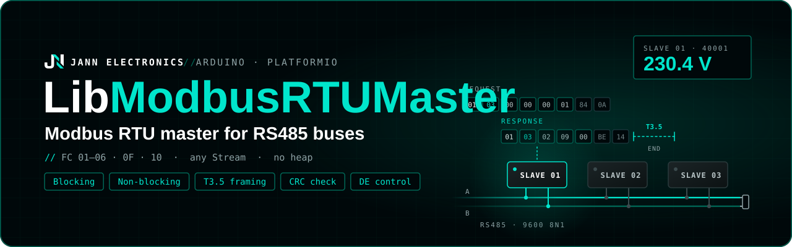

<p align="center">
  
</p>

# LibModbusRTUMaster

Modbus RTU master for RS485 buses, with strict frame validation and a non-blocking API that never
stalls the main loop.

```cpp
#include "ModbusRTUMaster.h"

ModbusRTU::Master master(Serial1, PIN_DE);

void setup() {
  Serial1.begin(9600, SERIAL_8N1, PIN_RX, PIN_TX);
  master.begin(9600);
}

void loop() {
  // slave 1, 4 holding registers from address 0
  ModbusRTU::Response r = master.transaction({1, ModbusRTU::Function::ReadHoldingRegisters, 0, 4});
  if (r.ok()) Serial.println(r.getRegister(0));
}
```

- Function codes **0x01 to 0x06, 0x0F and 0x10**: read and write coils, discrete inputs, holding
  and input registers.
- **Blocking** (`transaction()`) or **non-blocking** (`sendRequest()` + `poll()`) transactions.
- The end of a response is detected by the **3.5 character silence** the standard defines, so the
  library never reads a frame that is only half received, at any baud rate.
- Every response is validated: **CRC**, slave address, function code, frame length, byte count and
  the echo of write requests. Slave exceptions are reported as error codes.
- RS485 direction control with a **DE pin**, **callbacks**, or by the UART itself.
- Works with any `Stream` (`HardwareSerial`, `SoftwareSerial`, ...) on any Arduino core. No
  dynamic memory.

## Contents

- [LibModbusRTUMaster](#libmodbusrtumaster)
  - [Contents](#contents)
  - [Installation](#installation)
  - [Wiring](#wiring)
  - [Quick start](#quick-start)
  - [How it works](#how-it-works)
    - [Frame timing](#frame-timing)
    - [Response validation](#response-validation)
  - [Requests and responses](#requests-and-responses)
    - [Addresses](#addresses)
    - [Registers](#registers)
    - [Coils and discrete inputs](#coils-and-discrete-inputs)
    - [Maximum quantities](#maximum-quantities)
  - [Non-blocking transactions](#non-blocking-transactions)
  - [Driving the transceiver](#driving-the-transceiver)
  - [Errors](#errors)
  - [Configuration macros](#configuration-macros)
  - [Defaults](#defaults)
  - [API reference](#api-reference)
  - [Thread safety](#thread-safety)
  - [Examples](#examples)
  - [Notes and limitations](#notes-and-limitations)
  - [License](#license)

## Installation

**PlatformIO**, in `platformio.ini`:

```ini
lib_deps = https://github.com/Jann-Electronics/LibModbusRTUMaster.git
```

**Anything else**: copy `src/ModbusRTUMaster.h` and `src/ModbusRTUMaster.cpp` into your project.

```cpp
#include "ModbusRTUMaster.h"
```

Everything lives in the `ModbusRTU` namespace: `ModbusRTU::Master`, `ModbusRTU::Request`,
`ModbusRTU::Response`, `ModbusRTU::Function` and `ModbusRTU::Error`.

## Wiring

The microcontroller talks to the bus through an RS485 transceiver (MAX485, MAX3485, SP3485, ...):

| Transceiver | Microcontroller                                            |
| ----------- | ---------------------------------------------------------- |
| `DI`        | UART TX                                                    |
| `RO`        | UART RX                                                    |
| `DE` + `/RE`| Tied together to one GPIO: the `de_pin` of the constructor |
| `A`, `B`    | Bus lines, to `A` and `B` of every slave                   |

- **Termination**: a 120 Ω resistor between A and B at each end of the bus.
- **Bias**: one pull-up on A and one pull-down on B (typically 560 Ω to 1 kΩ) keep the line idle
  while nobody transmits. Without them, the line floats when the master releases DE, and the UART
  can read a spurious `0x00`. The library discards those bytes, but noise in the middle of a
  response still shows up as `Error::InvalidCrc`.
- Modules with automatic direction control (no DE pin) work without `de_pin`.

## Quick start

Read 4 holding registers of slave 1 and write one register back:

```cpp
#include <Arduino.h>
#include "ModbusRTUMaster.h"

constexpr int8_t PIN_RX = 18;
constexpr int8_t PIN_TX = 17;
constexpr int8_t PIN_DE = 8;

ModbusRTU::Master master(Serial1, PIN_DE);

void setup() {
  Serial.begin(115200);

  // The serial port is started by the application. Baud rate and parity must match the slave
  Serial1.begin(9600, SERIAL_8N1, PIN_RX, PIN_TX);
  master.begin(9600); // same baud rate: used for the frame timing
  master.setTimeout(500);
}

void loop() {
  ModbusRTU::Response r = master.transaction({1, ModbusRTU::Function::ReadHoldingRegisters, 0, 4});

  if (r.ok()) {
    for (uint8_t i = 0; i < 4; i++) {
      Serial.printf("HR[%u] = %u\n", i, r.getRegister(i));
    }
  } else {
    Serial.printf("Error: %s\n", ModbusRTU::toString(r.error));
  }

  const uint16_t setpoint = 250;
  r = master.transaction({1, ModbusRTU::Function::WriteSingleRegister, 10, 1}, &setpoint);

  delay(1000);
}
```

`transaction()` blocks until the response arrives or the timeout expires. To keep the loop running
while the slave answers, see [Non-blocking transactions](#non-blocking-transactions).

## How it works

### Frame timing

Modbus RTU has no start or end markers: a frame ends when the line stays silent for **3.5
characters** (T3.5). The library sends the request, then:

1. Waits up to the **timeout** (`setTimeout()`, 1000 ms by default) for the first byte of the
   response. If nothing arrives, the result is `Error::Timeout`.
2. Collects bytes until T3.5 passes without a new one. Only then is the frame complete and parsed.

| Baud rate     | T3.5                                   |
| ------------- | -------------------------------------- |
| 9600          | 4010 µs                                |
| 19200         | 2005 µs                                |
| above 19200   | 1750 µs (fixed by the specification)   |

T3.5 assumes 11 bits per character (start, 8 data, parity or a second stop bit, stop), as the
specification does. With 8N1 the real character is 10 bits, so the silence is slightly longer than
needed, which is harmless.

Because the end of a frame is a silence, the response is only complete T3.5 after its last byte:
a 9-byte response at 9600 takes about 10 ms to arrive and 4 ms more to be accepted.

### Response validation

A response is accepted only if all of these hold, checked in this order:

1. At least 5 bytes, and no more than the buffer (`InvalidFrameSize`, `BufferOverflow`).
2. **CRC** correct (`InvalidCrc`). Nothing else in the frame is trusted before this.
3. Same **slave address** as the request (`InvalidDeviceId`).
4. Same **function code** (`InvalidFunction`). With bit 7 set, it is an exception and its code is
   returned as the error (`IllegalDataAddress`, `SlaveDeviceBusy`, ...).
5. **Length** consistent with the function and its byte count (`InvalidFrameSize`).
6. **Byte count** matching the quantity requested, or **echo** matching the write request
   (`InvalidResponse`).

Bytes left over from an earlier transaction (a late response after a timeout, the echo of a
transceiver with its receiver always enabled) are discarded before and after each request.

## Requests and responses

```cpp
struct Request {
  uint8_t address;   // slave address, 1 to 247
  Function function; // function code
  uint16_t reg;      // first register or coil, as a 0-based protocol address
  uint16_t quantity; // registers or coils (ignored by the single write functions)
};
```

`transaction()` and `poll()` return a `Response`:

| Member                | Description                                                          |
| --------------------- | -------------------------------------------------------------------- |
| `request`             | The request this response answers.                                   |
| `error`               | `Error::None` on success.                                            |
| `ok()`                | `error == Error::None`.                                              |
| `getRegister(i)`      | Register `i`, counted from `request.reg`. 0 if out of range.         |
| `getCoil(i)`          | Coil or discrete input `i`, counted from `request.reg`. `false` if out of range. |
| `data_bytes`          | Data bytes received (read functions only).                           |
| `values[]`            | Raw storage behind `getRegister()` / `getCoil()`.                    |

Use the values only when `ok()` is `true`. On error they are 0.

### Addresses

`reg` is the address that travels in the frame, starting at 0. Many datasheets use the classic
numbering instead, where the first holding register is **40001**: subtract the offset of the table.

| Datasheet numbering | Table             | Function                | `reg`              |
| ------------------- | ----------------- | ----------------------- | ------------------ |
| 00001 – 09999       | Coils             | `ReadCoils`, `Write...Coil(s)` | number − 1   |
| 10001 – 19999       | Discrete inputs   | `ReadDiscreteInputs`    | number − 10001     |
| 30001 – 39999       | Input registers   | `ReadInputRegisters`    | number − 30001     |
| 40001 – 49999       | Holding registers | `ReadHoldingRegisters`, `Write...Register(s)` | number − 40001 |

### Registers

Registers are raw 16-bit words (`uint16_t`). Interpret them as the slave documents:

```cpp
// Signed value
int16_t temperature = static_cast<int16_t>(r.getRegister(0)); // e.g. 0xFF9C -> -100

// 32-bit value in two registers, high word first (some devices use the opposite order)
uint32_t energy = (static_cast<uint32_t>(r.getRegister(0)) << 16) | r.getRegister(1);

// IEEE 754 float in two registers
float voltage;
uint32_t raw = (static_cast<uint32_t>(r.getRegister(2)) << 16) | r.getRegister(3);
memcpy(&voltage, &raw, sizeof(voltage));
```

Write functions take the values in an array (or a pointer to a single value):

```cpp
const uint16_t value = 1234;
master.transaction({1, ModbusRTU::Function::WriteSingleRegister, 10, 1}, &value);

const uint16_t values[] = {100, 200, 300};
master.transaction({1, ModbusRTU::Function::WriteMultipleRegisters, 20, 3}, values);
```

### Coils and discrete inputs

Read them with `getCoil(i)`. To write several coils, pack them **16 per word**: coil `i` is bit
`i % 16` of `values[i / 16]`, the first coil in bit 0.

```cpp
// Coils 0..9: ON OFF ON ON OFF OFF ON ON ON OFF
const uint16_t coils[] = {0b0000000111001101};
master.transaction({1, ModbusRTU::Function::WriteMultipleCoils, 0, 10}, coils);

// Single coil: any non-zero value turns it on
const uint16_t on = 1;
master.transaction({1, ModbusRTU::Function::WriteSingleCoil, 5, 1}, &on);

ModbusRTU::Response r = master.transaction({1, ModbusRTU::Function::ReadCoils, 0, 10});
bool coil_2 = r.getCoil(2);
```

### Maximum quantities

The quantity a single request can carry depends on the frame buffer size
([`MODBUS_RTU_BUFFER_SIZE`](#configuration-macros)). A request above the limit is rejected with
`Error::InvalidRequest`, never truncated; split it into several requests.

| Function                                     | Buffer 64 (default) | Buffer 256 | Specification |
| -------------------------------------------- | ------------------- | ---------- | ------------- |
| `ReadCoils`, `ReadDiscreteInputs`            | 432                 | 1968       | 2000          |
| `ReadHoldingRegisters`, `ReadInputRegisters` | 27                  | 123        | 125           |
| `WriteMultipleCoils`                         | 432                 | 1968       | 1968          |
| `WriteMultipleRegisters`                     | 27                  | 123        | 123           |

`ModbusRTU::maxQuantity(function)` returns the limit at runtime.

## Non-blocking transactions

`sendRequest()` transmits the request and returns at once. `poll()`, called from `loop()`, collects
the response as it arrives and returns `true` when the transaction finished, successfully or not:

```cpp
void loop() {
  static uint32_t last_ms = 0;

  if (!master.isBusy() && millis() - last_ms >= 200) {
    last_ms = millis();
    master.sendRequest({1, ModbusRTU::Function::ReadInputRegisters, 0, 2});
  }

  ModbusRTU::Response r;
  if (master.poll(r)) {
    if (r.ok()) {
      Serial.println(r.getRegister(0));
    } else {
      Serial.println(ModbusRTU::toString(r.error));
    }
  }

  // the rest of the program keeps running while the slave answers
}
```

- Only one transaction can be pending: `sendRequest()` returns `false` while `isBusy()`.
- `sendRequest()` also returns `false` if `begin()` was not called or the request is invalid.
  `transaction()` reports the same cases as `Error::NotReady` and `Error::InvalidRequest`.
- `poll()` detects the end of the response by the T3.5 silence, measured between calls. Call it at
  least every few milliseconds; if the loop stalls for longer, the response is only accepted late,
  never cut short.
- The transmission itself still blocks for the time the request takes on the wire (about 9 ms for
  an 8-byte request at 9600), because `flush()` must return before DE is released.
- `cancel()` drops the pending transaction. A response that arrives later is discarded by the next
  request.

## Driving the transceiver

**DE pin.** Pass the GPIO tied to DE and /RE to the constructor. `begin()` sets it as an output,
low. It goes high right before each request and low once the last bit has left the UART.

```cpp
ModbusRTU::Master master(Serial1, PIN_DE);
```

**Callbacks.** For anything a plain GPIO cannot do (an IO expander, separate DE and /RE pins, an
activity LED), register callbacks. They run right before the request and right after the last
bit, in addition to the DE pin if there is one:

```cpp
ModbusRTU::Master master(Serial1); // no DE pin

master.onBeforeTransmit([]() { expander.digitalWrite(DE_PIN, HIGH); });
master.onAfterTransmit([]() { expander.digitalWrite(DE_PIN, LOW); });
```

The callbacks are plain function pointers: lambdas without captures are accepted.

**ESP32 hardware RS485.** The ESP32 UART can drive DE by itself through its RTS pin, with exact
timing and no work for the CPU. Construct the master without a DE pin:

```cpp
ModbusRTU::Master master(Serial1);

void setup() {
  Serial1.begin(9600, SERIAL_8N1, PIN_RX, PIN_TX);
  Serial1.setPins(-1, -1, -1, PIN_DE); // RTS drives DE and /RE
  Serial1.setMode(UART_MODE_RS485_HALF_DUPLEX);
  master.begin(9600);
}
```

## Errors

`Response::error` is `Error::None` on success. Codes `0x01` to `0x0B` are exceptions sent by the
slave; codes from `0xE0` are detected by the master. `ModbusRTU::toString(error)` returns a
readable name.

| Error                     | Code   | Meaning / usual cause                                                |
| ------------------------- | ------ | -------------------------------------------------------------------- |
| `IllegalFunction`         | `0x01` | The slave does not support the function.                             |
| `IllegalDataAddress`      | `0x02` | Register or coil not available on the slave (check the address offset). |
| `IllegalDataValue`        | `0x03` | Value or quantity not accepted by the slave.                         |
| `SlaveDeviceFailure`      | `0x04` | The slave failed while executing the request.                        |
| `Acknowledge`             | `0x05` | Accepted, but it will take long to complete.                         |
| `SlaveDeviceBusy`         | `0x06` | The slave is busy: retry later.                                      |
| `NegativeAcknowledge`     | `0x07` | The slave cannot perform the request.                                |
| `MemoryParityError`       | `0x08` | Memory parity error on the slave.                                    |
| `GatewayPathUnavailable`  | `0x0A` | Gateway: no path to the target.                                      |
| `GatewayTargetNoResponse` | `0x0B` | Gateway: the target did not respond.                                 |
| `InvalidDeviceId`         | `0xE0` | Response from another slave address.                                 |
| `InvalidFunction`         | `0xE1` | Response function code does not match the request.                   |
| `InvalidCrc`              | `0xE2` | CRC mismatch: noise, missing bias or termination, or a baud rate / parity mismatch. |
| `InvalidFrameSize`        | `0xE3` | Response too short or its length does not match the function.        |
| `BufferOverflow`          | `0xE4` | Response longer than `MODBUS_RTU_BUFFER_SIZE`.                       |
| `Timeout`                 | `0xE5` | No response within the timeout: wiring, A/B swapped, address, baud rate. |
| `NotReady`                | `0xE6` | `begin()` not called, or another request is still pending.           |
| `InvalidRequest`          | `0xE7` | Address outside 1–247, unsupported function, quantity 0 or above the limit, or write without values. |
| `InvalidResponse`         | `0xE8` | Byte count or write echo does not match the request.                 |

## Configuration macros

| Macro                    | Default | Description                                                            |
| ------------------------ | ------- | ---------------------------------------------------------------------- |
| `MODBUS_RTU_BUFFER_SIZE` | `64`    | Frame buffer in bytes, 16 to 256. Sets the [maximum quantities](#maximum-quantities). Each `Master` holds one buffer and each `Response` about the same size again, so keep it small on boards with little RAM. |

Define it in `build_flags`, for example `-DMODBUS_RTU_BUFFER_SIZE=256`.

## Defaults

| Setting           | Default                                  |
| ----------------- | ---------------------------------------- |
| Response timeout  | 1000 ms                                  |
| DE pin            | none (`-1`)                              |
| Callbacks         | none                                     |
| Frame buffer      | 64 bytes: 27 registers / 432 coils       |

## API reference

**`ModbusRTU::Master`**

| Method                                     | Description                                                               |
| ------------------------------------------ | ------------------------------------------------------------------------- |
| `Master(serial, de_pin = -1)`              | `serial` is started by the application. `de_pin` drives DE and /RE.       |
| `begin(baudrate)`                          | Sets up the DE pin and the frame timing. `false` if `baudrate` is 0.      |
| `setTimeout(ms)` / `getTimeout()`          | Time the slave has to start answering.                                    |
| `getT35()`                                 | Frame end silence at the current baud rate, in µs.                        |
| `onBeforeTransmit(cb)` / `onAfterTransmit(cb)` | Callbacks around each request.                                        |
| `transaction(request, values)`             | Sends a request and returns the `Response`. Blocking.                     |
| `sendRequest(request, values)`             | Sends a request without waiting. `false` if not ready or invalid.         |
| `poll(response)`                           | `true` once the pending transaction finished, with its result.            |
| `isBusy()`                                 | A transaction is pending.                                                 |
| `cancel()`                                 | Drops the pending transaction.                                            |
| `getPendingRequest()`                      | The pending (or last) request.                                            |

`values` is only needed by the write functions: registers, or coils packed 16 per word.

**Free functions**

| Function                        | Description                                                           |
| ------------------------------- | --------------------------------------------------------------------- |
| `toString(Error)`               | Readable name of an error.                                            |
| `toString(Function)`            | Readable name of a function code.                                     |
| `isReadFunction(Function)`      | `true` for 0x01 to 0x04.                                              |
| `isRegisterFunction(Function)`  | `true` for the functions that access registers, `false` for coils / inputs. |
| `maxQuantity(Function)`         | Largest quantity per request with the current buffer.                 |
| `crc16(data, length)`           | Modbus CRC-16. The frame carries it low byte first.                   |
| `t35Micros(baudrate)`           | T3.5 for a baud rate, in µs.                                          |

## Thread safety

`ModbusRTU::Master` is not thread-safe, and a bus carries one transaction at a time anyway. If
several FreeRTOS tasks share the bus, give the master to one task and send it requests through a
queue, or protect it with a mutex, for example with
[LibSafeWrap](https://github.com/Jann-Electronics/LibSafeWrap):

```cpp
SafeWrap<ModbusRTU::Master> master{ModbusRTU::Master(Serial1, PIN_DE)};

// setup()
(void)master.withLock([](ModbusRTU::Master& m) { m.begin(9600); }, portMAX_DELAY);

// any task
ModbusRTU::Response r;
bool locked = master.withLock([&](ModbusRTU::Master& m) {
  r = m.transaction({1, ModbusRTU::Function::ReadHoldingRegisters, 0, 2});
}, pdMS_TO_TICKS(2000));
```

The lock timeout must cover a whole transaction: up to the response timeout plus the time the
response takes on the wire.

## Examples

| Example                                                         | What it shows                                                        |
| --------------------------------------------------------------- | -------------------------------------------------------------------- |
| [`examples/basic`](examples/basic/basic.cpp)                    | Reading holding registers and writing single and multiple registers  |
| [`examples/coils`](examples/coils/coils.cpp)                    | Writing and reading coils with the 16-per-word packing, discrete inputs |
| [`examples/non_blocking`](examples/non_blocking/non_blocking.cpp) | Polling three slaves in turn with `sendRequest()` / `poll()` while the loop keeps running |

The examples are written for an ESP32-S3; adjust the pins for your board. To build one with
PlatformIO, select it with `src_dir` in [platformio.ini](platformio.ini).

## Notes and limitations

- Master only: the library cannot act as a slave.
- Broadcast (address 0) is not supported: every request expects a response.
- Function codes other than 0x01–0x06, 0x0F and 0x10 (diagnostics, file records, read/write
  multiple registers, ...) are not supported.
- `transaction()` and `poll()` must not be called from an interrupt handler.
- `SoftwareSerial` disables interrupts while it sends or receives a byte and cannot transmit and
  receive at the same time. Prefer a hardware UART, especially above 9600 baud.

## License

Released under the [MIT License](LICENSE).
